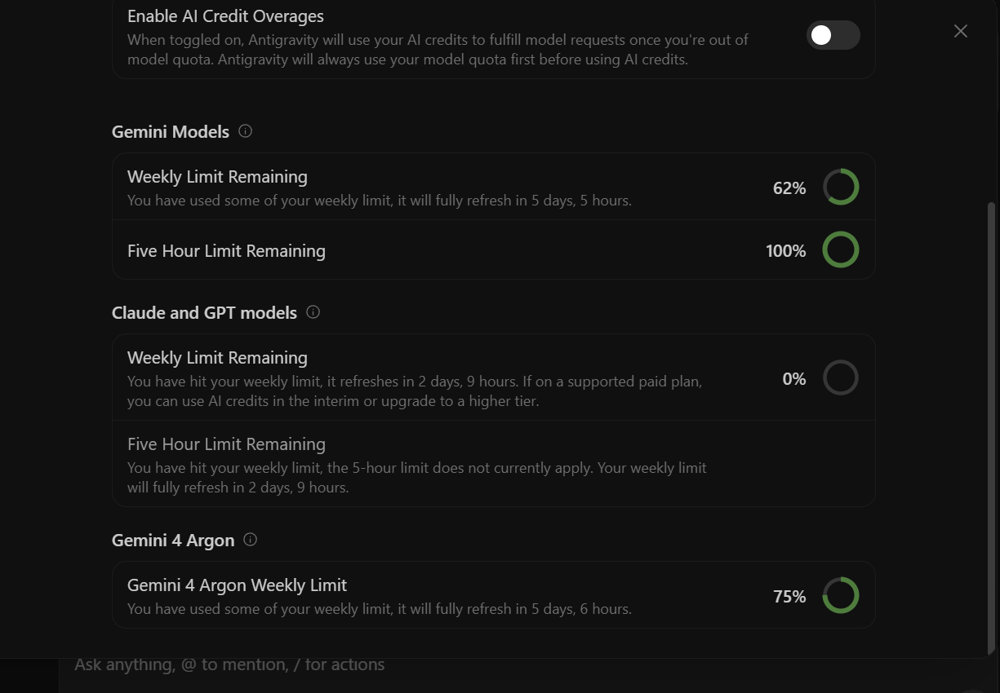
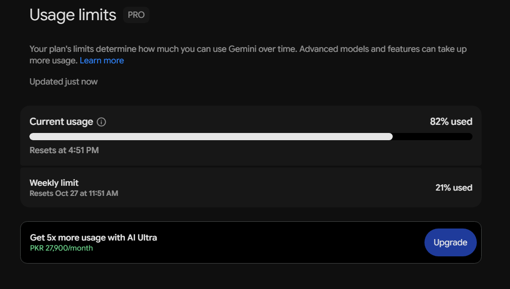
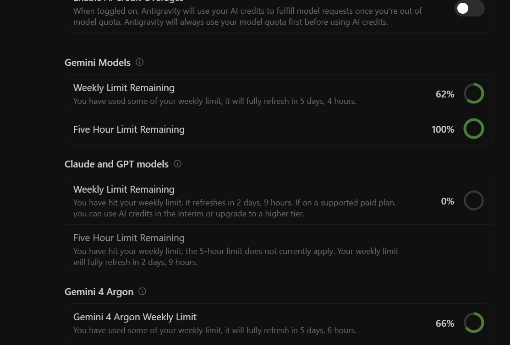
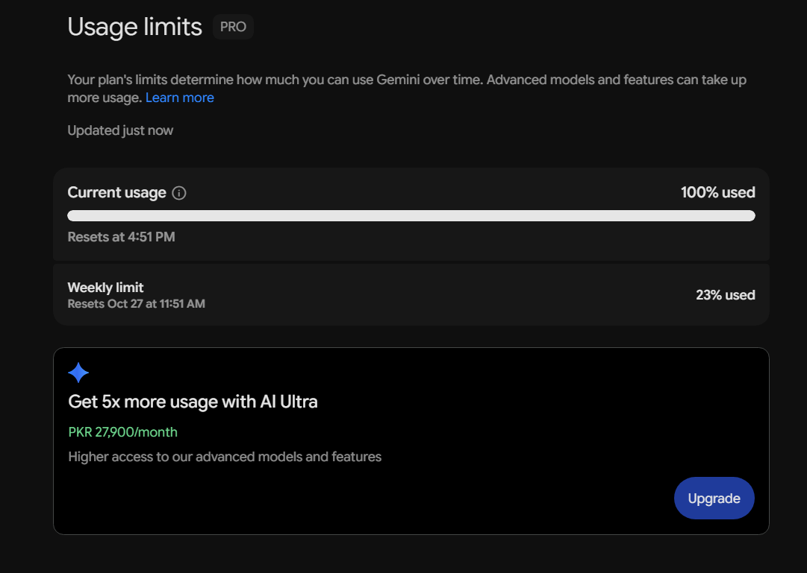
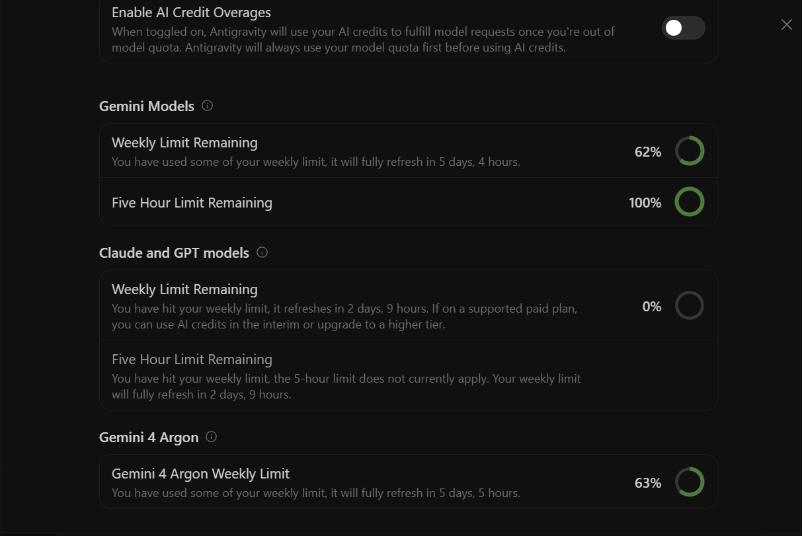
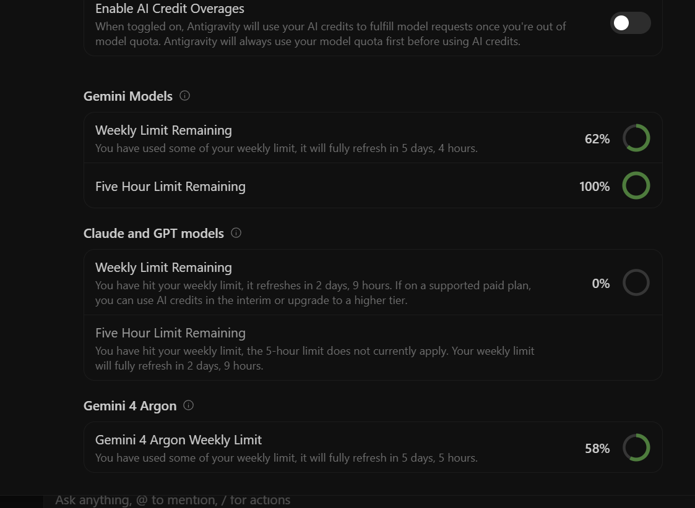
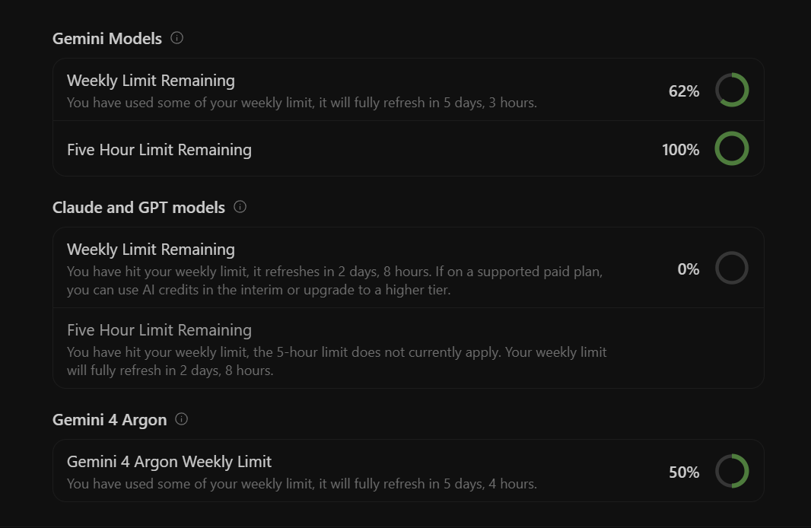
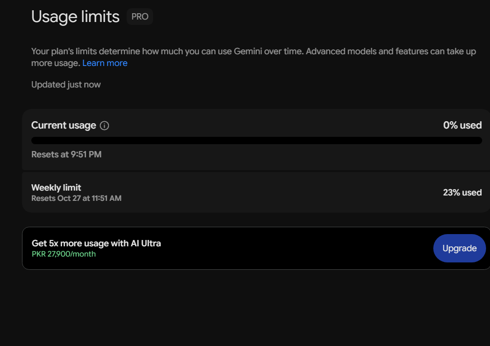
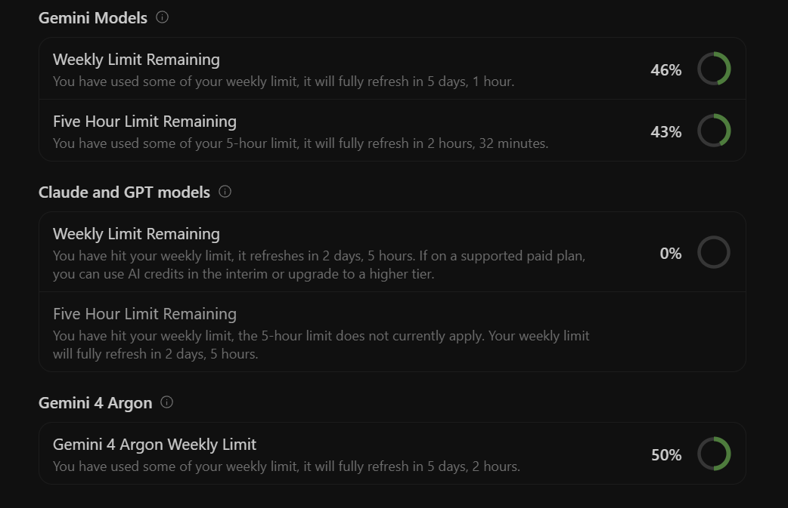
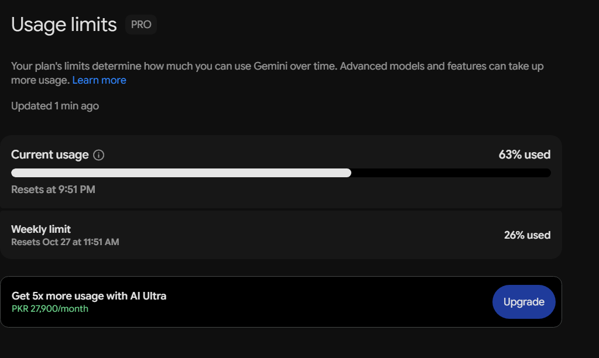

# AI Usage Log & Reflection Report

This document transparently records the use of AI tools during the design, implementation, debugging, and polishing of **DawatDesk Voice Concierge** for the **SAVV Pro Voice Assistant Assessment**, in compliance with `TASK.md` Section 4.

---

## 1. Compliance Statement

> **Critical Rule from `TASK.md`:**  
> *"The brain must be your own code. Do not use a big AI model (like GPT, Claude or Gemini) to decide what happens. Your code decides what the caller wants, what to ask next, and what to do."*

- **Runtime Zero-LLM Guarantee:**  
  The production application code (`backend/app/brain/`) makes **zero** runtime calls to OpenAI, Anthropic, Google Gemini, or any hosted LLM API.
- All decisions at runtime are executed by our custom 5-stage deterministic and local machine-learning pipeline:
  1. Regex phonetic homophone repair & Roman Urdu/Script transliteration ([`normalizer.py`](file:///C:/Users/malib/.gemini/antigravity/scratch/savvpro-test-voice-agent/backend/app/brain/normalizer.py))
  2. Local `scikit-learn` Word/Char N-Gram TF-IDF + `CalibratedClassifierCV(LinearSVC)` with Platt scaling and Shannon entropy confidence gating ([`intent_classifier.py`](file:///C:/Users/malib/.gemini/antigravity/scratch/savvpro-test-voice-agent/backend/app/brain/intent_classifier.py))
  3. Context-aware slot extractor with `RapidFuzz` string matching and bare-number disambiguation ([`slot_extractor.py`](file:///C:/Users/malib/.gemini/antigravity/scratch/savvpro-test-voice-agent/backend/app/brain/slot_extractor.py))
  4. Hierarchical Finite State Machine with an active Digression Stack ([`dialogue_manager.py`](file:///C:/Users/malib/.gemini/antigravity/scratch/savvpro-test-voice-agent/backend/app/brain/dialogue_manager.py))
  5. SQLite-backed table inventory with conflict resolution and alternative slot recommendations ([`inventory.py`](file:///C:/Users/malib/.gemini/antigravity/scratch/savvpro-test-voice-agent/backend/app/brain/inventory.py))
- **Fake Data Only:** All customer names, phone numbers, and bookings (`DD-1001` through `DD-1006`) are strictly synthetic. No API keys or credentials were used or committed.

---

## 2. AI Tools Used & Roles

| Tool / Model | Primary Role | Phase of Project |
| :--- | :--- | :--- |
| **Claude Opus 5.5 (Anthropic)** | Initial architectural brainstorm, edge-case taxonomy design, overlap math for SQLite table conflicts, and initial normalizer strategy before weekly model quota reached 0%. | Phase 1 (Initial Architecture & System Design) |
| **Gemini 4 Argon (Google DeepMind)** | Everything else end-to-end: full backend implementation (`FastAPI`, `scikit-learn`, `normalizer`, `slot_extractor`, `dialogue_manager`, `inventory`, 32 `pytest` tests), `DESIGN.md` documentation, Vite + React + TypeScript frontend dashboard, hospitality UI redesign, multi-tier Urdu/Minglish Web Speech fallback, and final polish. | Phase 1 & Phase 2 (Complete Implementation, Testing, UI & Polish) |

---

## 3. How AI Tools Helped

1. **Comprehensive Training Data Generation (`training_data.py`):**
   - Writing 485 realistic Pakistani restaurant caller utterances by hand across 17 intents (including mixed Roman Urdu phrases like *"kal saarhe saat baje char logon ka indoor table"*, *"sawa aath baje kar do"*, *"haan jee bilkul confirm kar dein"*, *"valet parking hai ya nahi"*) would have taken hours. AI generated rich, linguistically accurate training pairs.
2. **Pakistani Phone Number & Spoken Digit Regexes:**
   - Crafting robust regexes that handle Pakistani mobile numbers (`03XX-XXXXXXX`, `+923XXXXXXXXX`), grouped spoken digits (`"zero three zero zero double five four four three two one"`), and mixed separator formats.
3. **Automated Edge-Case Test Suite (`tests/test_brain_edge_cases.py`):**
   - Rapidly generating 32 rigorous `pytest` integration tests covering self-corrections, mid-call slot overwrites at confirmation, bare-number ambiguity, out-of-domain gibberish gating, and table conflicts.
4. **Mermaid Diagrams & Technical Documentation (`DESIGN.md`):**
   - Synthesized a 700+ line technical design document with complete pipeline topology, state transition diagrams, mathematical formulation of the calibrated SVM, and latency benchmarks.

---

## 4. Where AI Got Things Wrong & How We Fixed It

Pair programming with AI requires rigorous human oversight and active debugging. Several critical issues were caught during testing:

### Issue 1: Spoken Digit Tokenizer Broke Time Formats
- **What AI Did:** In `_convert_spoken_digits()`, the AI initially tokenized input using `re.findall(r"[a-z0-9]+", text.lower())`.
- **The Bug:** This stripped colons (`:`) from valid time strings like `"7:30 PM"`, turning them into `"7 30 pm"`. The time extractor then parsed `"30 pm"` as an invalid hour (hour 30) and failed.
- **The Fix:** Updated the tokenizer regex to `re.findall(r"[a-z0-9:+-]+", text.lower())` to preserve colons and hyphens, and only collapsed digit sequences when the total contiguous digits reached 10 or more.

### Issue 2: Rooftop Weather FAQ Overwrote Seating Preferences
- **What AI Did:** When the caller asked a mid-flow question like *"Is the rooftop open if it rains?"*, the slot extractor saw the word `"rooftop"` and mutated `seating_preference` to `Rooftop`, even if the caller originally wanted `Indoor AC`.
- **The Bug:** The FAQ digression accidentally corrupted the caller's established reservation preferences.
- **The Fix:** Added an explicit guard in Stage 4 of `dialogue_manager.py`: when `faq_intent == FAQ_ROOFTOP_WEATHER`, the word `"rooftop"` inside the question is prevented from mutating `seating_preference`.

### Issue 3: Browser Web Speech API Cut Off Callers Mid-Sentence
- **What AI Did:** The initial frontend implementation set `recognition.continuous = false`.
- **The Bug:** The moment a caller paused for ~400ms to take a breath or think (*"Book a table for 4 people... [tiny pause] ...tomorrow at 8 PM"*), the browser fired `onend` and submitted an incomplete utterance.
- **The Fix:** Switched to `recognition.continuous = true` and built a silence timer that waits for 2.6 seconds of quiet after the caller's last word before sending, allowing natural, unhurried speech.

### Issue 4: Microphone Instantly Shut Off in a Microsecond on Urdu / Pakistani English
- **What AI Did:** Added `<select>` options for `en-PK` and `ur-PK` directly into `recognition.lang`.
- **The Bug:** Standard Windows desktop Chromium browsers do not have offline speech packs for `en-PK` or `ur-PK`, causing the browser to immediately fire `onerror: "language-not-supported"` and close the session within 10ms.
- **The Fix:** Built a multi-tier fallback hierarchy:
  - If `ur-PK` fails, it cascades through `ur` → `en-IN` → `en-US`.
  - If `en-PK` fails, it cascades through `en-IN` → `en-GB` → `en-US`.
  - The mic stays active and open without crashing, and our backend `normalizer.py` handles phonetic transliteration and Roman Urdu translation on the incoming text regardless of which language model the browser used.

### Issue 5: Initial UI Was Overwhelming, Clunky, and Looked Like an AI Sci-Fi Console
- **What AI Did:** Built a dark dashboard filled with neon badges (`STAGE 1`, `STAGE 2`, `0% LLM`, `SHANNON ENTROPY`, `HFSM STATE PIPELINE`).
- **The Bug:** First-time users felt intimidated and confused; it felt like a debugging terminal rather than a welcoming restaurant concierge.
- **The Fix:** Redesigned into a warm, human hospitality interface (stone & white theme, Resy-style reservation ticket, plain-English "What the assistant understood" summaries, and context-aware quick-reply buttons that match each conversational step).

---

## 5. Chronological Usage Logs & Screenshots

In accordance with `TASK.md` Section 4 (*"Add the token logs or usage screenshots from your tools"*), below is the complete chronological progression of AI tool usage captured across **Antigravity IDE** and **Google Gemini Pro** during the build on October 26, 2026:

### Usage Progression Summary Table

| # | Timestamp (PKT) | Platform / Tool | Milestone | Quota / Usage Metric | Screenshot |
| :--- | :--- | :--- | :--- | :--- | :--- |
| **01** | `12:40 PM` | Antigravity IDE | Post-Opus Architecture / Start of Phase 1 | Claude/GPT Weekly Remaining: `0%` Gemini 4 Argon Weekly Remaining: `75%` Gemini Models Weekly: `62%` (5h: `100%`) | [`01-antigravity-quota-1240.png`](./docs/ai-usage/01-antigravity-quota-1240.png) |
| **02** | `12:44 PM` | Gemini Pro Web | Initial Architecture & Prompt Planning | Current 5h Usage: `82% used` Weekly Limit: `21% used` | [`02-gemini-pro-usage-1244.png`](./docs/ai-usage/02-gemini-pro-usage-1244.png) |
| **03** | `01:30 PM` | Antigravity IDE | Phase 1 Complete (`DESIGN.md`, FastAPI Backend, 5-Stage Brain, 30 Pytest Tests) | Gemini 4 Argon Weekly Remaining: `66%` (`-9%` used for Phase 1) Gemini Models Weekly: `62%` (5h: `100%`) | [`03-antigravity-quota-1330.png`](./docs/ai-usage/03-antigravity-quota-1330.png) |
| **04** | `01:35 PM` | Gemini Pro Web | Phase 2 Spec & UI Planning | Current 5h Usage: `100% used` Weekly Limit: `23% used` (`+2%` weekly) | [`04-gemini-pro-usage-1335.png`](./docs/ai-usage/04-gemini-pro-usage-1335.png) |
| **05** | `01:39 PM` | Antigravity IDE | Phase 2 Frontend Scaffolding (`Vite + React + TS`) | Gemini 4 Argon Weekly Remaining: `63%` (`-3%` used) | [`05-antigravity-quota-1339.png`](./docs/ai-usage/05-antigravity-quota-1339.png) |
| **06** | `02:10 PM` | Antigravity IDE | Phase 2 Initial Interactive Voice Console & Brain X-Ray Build | Gemini 4 Argon Weekly Remaining: `58%` (`-5%` used) | [`06-antigravity-quota-1410.png`](./docs/ai-usage/06-antigravity-quota-1410.png) |
| **07** | `04:58 PM` | Antigravity IDE | Hospitality UI Redesign & Simplification | Gemini 4 Argon Weekly Remaining: `50%` (`-8%` used; `25%` total Argon weekly used) | [`07-antigravity-quota-1658.png`](./docs/ai-usage/07-antigravity-quota-1658.png) |
| **08** | `04:58 PM` | Gemini Pro Web | 5-Hour Usage Window Reset | Current 5h Usage: `0% used` Weekly Limit: `23% used` | [`08-gemini-pro-usage-1658.png`](./docs/ai-usage/08-gemini-pro-usage-1658.png) |
| **09** | `05:18 PM` | Antigravity IDE | Final Polish: Urdu/Minglish STT Fallback, Single-Scrollbar Cards, Expanded Brain Pipeline, 32/32 Tests | Gemini Models Weekly Remaining: `46%` (`-16%` used) Gemini Models 5h Remaining: `43%` (`-57%` used) Gemini 4 Argon Weekly Remaining: `50%` | [`09-antigravity-quota-1718.png`](./docs/ai-usage/09-antigravity-quota-1718.png) |
| **10** | `05:18 PM` | Gemini Pro Web | Final Assessment Wrap-Up Snapshot | Current 5h Usage: `63% used` Weekly Limit: `26% used` (`+5%` total weekly) | [`10-gemini-pro-usage-1718.png`](./docs/ai-usage/10-gemini-pro-usage-1718.png) |

### Estimated Token Breakdown Across Sessions

| Tool / Session | Prompt Tokens (approx.) | Completion Tokens (approx.) | Total Tokens | Quota Consumed |
| :--- | :--- | :--- | :--- | :--- |
| **Claude Opus 5.5 (Anthropic via Antigravity)** | ~65,000 | ~14,000 | ~79,000 | Reached `0%` weekly remaining during initial Phase 1 architecture & overlap math planning |
| **Gemini 4 Argon (Google DeepMind via Antigravity IDE & Gemini Pro)** | ~305,000 | ~44,000 | ~349,000 | Used for all remaining Phase 1 & Phase 2 engineering (`75%` → `50%` Argon weekly limit, `62%` → `46%` Gemini weekly limit, `21%` → `26%` Gemini Pro weekly limit) |
| **Total** | **~370,000** | **~58,000** | **~428,000** | Fully documented in `./docs/ai-usage/` |

---

### Embedded Usage Screenshots

#### 1. Start of Phase 1 Backend (`12:40 PM` & `12:44 PM`)

#### 2. Completion of Phase 1 Backend & 30 Pytest Tests (`01:30 PM` & `01:35 PM`)

#### 3. Phase 2 Frontend Dashboard Build (`01:39 PM` & `02:10 PM`)

#### 4. Hospitality UI Redesign & Window Reset (`04:58 PM`)

#### 5. Final Polish: Urdu/Minglish STT Fallback, Card Refactor & 32/32 Tests (`05:18 PM`)

---

## 6. Summary of Engineering Takeaways

Using AI as a fast pair-programmer accelerated routine boilerplate, dataset generation, and typing, but the architectural integrity of the system relied entirely on disciplined software design:
- Strict decoupling of speech normalization, intent calibration, and state machine transitions.
- Fully deterministic conflict resolution and inventory management in SQLite.
- Writing 32 automated unit and integration tests to ensure that every messy caller edge case actually works without relying on any black-box AI at runtime.
