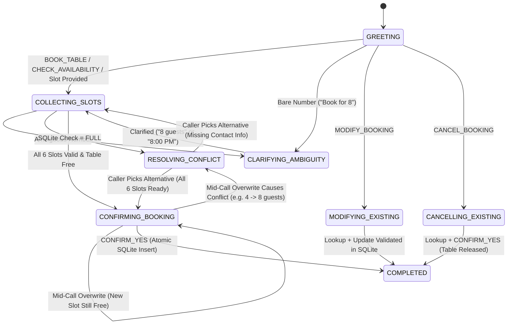

# System Design: DawatDesk Voice Concierge (`Haveli Grill & Courtyard, Islamabad`)

> **Strict Assessment Rule Compliance:**
> The decision-making brain of **DawatDesk Voice Concierge** is **100% custom Python code**. No external Large Language Models (no OpenAI/GPT, Anthropic/Claude, Google Gemini, or hosted LLM APIs) are used anywhere in the repository. All intent classification, confidence calibration, slot extraction, self-correction parsing, state transitions, digression handling, and inventory conflict resolution execute locally and deterministically in `< 15 ms` per turn.

---

## 1. Use Case & Why Restaurant Phone Calls in Pakistan Are Uniquely Messy

**DawatDesk Voice Concierge** is an automated telephone receptionist built for **Haveli Grill & Courtyard**, a high-volume fine-dining and charcoal-grill restaurant in **F-7 Markaz, Islamabad**.

Real-world phone reservations in Pakistan violate almost every assumption of rigid IVR trees:

1. **Bilingual Code-Switching (Pakistani Minglish / Roman Urdu):**
   Callers seamlessly mix English and Urdu within a single breath:
   - *"Salam, kal raat 8 baje 4 logon ka table book karna hai indoor mein"*
   - *"Parso saarhe saat baje char log chhat pe"*
   - *"Haan jee bilkul confirm kar dein"* / *"Nahi 8 baje nahi, 9 baje kar do"*
   - Fractional Urdu clock idioms: *saarhe* (`:30`), *sawa* (`:15`), *paune* (`-1 hr :45`), *derh baje* (`1:30 PM`), and *dhai baje* (`2:30 PM`).
2. **STT Homophone Corruptions on Cellular Lines:**
   Browser and telephony Speech-to-Text engines routinely transcribe numbers as English homophones:
   - *"table for people"* $\rightarrow$ `4 people`
   - *"at ate pm"* $\rightarrow$ `8 pm`
   - *"table for for at to pm"* $\rightarrow$ `table for 4 at 2 pm`
3. **Intra-Utterance Self-Corrections (Speech Repairs):**
   Callers think out loud and revise numbers mid-sentence:
   - *"Book a table for 3 people—sorry, 5 people—tomorrow at 8 PM"*
   - *"Book for 4 people tomorrow at 7 PM, no wait make it 8:30 PM"*
4. **Mid-Call & Last-Second Slot Overwrites (The "Uncle's Family" Problem):**
   A caller completes every step and reaches the final confirmation read-back, then says:
   - *"Wait, my uncle's family is coming too, make it 8 people!"*
   - *"Actually make it 8:30 PM instead."*
   Updating `party_size`, `date`, `time`, or `seating_preference` during `CONFIRMING_BOOKING` **must invalidate the prior table check and re-verify SQLite inventory** before confirming, because a table that was free for 4 guests at 8:00 PM may be completely full for 8 guests at 8:00 PM.
5. **Mid-Flow FAQ Interruptions (Digressions):**
   When asked *"What time would you like to dine?"*, callers frequently reply with a question of their own:
   - *"Wait, do you guys have valet parking?"*
   - *"Is the rooftop open if it rains?"*
   - *"Do you take credit cards?"*
   The assistant must answer the question accurately, **avoid falsely committing FAQ keywords as booking slots** (e.g., not overwriting seating to `Rooftop` just because the caller asked *"Is the rooftop open if it rains?"*), and immediately re-prompt for the exact missing slot without losing a single previously collected field.
6. **Ambiguous Bare Numbers:**
   When a caller opens with *"Book for 8"*, `8` could mean **8 guests** or **8:00 PM**. Guessing wrong derails the call.

---

## 2. Five-Stage Non-LLM Brain Architecture

### 2.1 High-Level ASCII Pipeline

```text
+-----------------------------------------------------------------------------------+
|                              CALLER AUDIO / TEXT TURN                             |
+-----------------------------------------------------------------------------------+
                                         |
                                         v
+-----------------------------------------------------------------------------------+
| STAGE 1: NORMALIZER & SPEECH REPAIR (`app/brain/normalizer.py`)                   |
|  - Disfluency & filler stripping ("um", "uh", "er")                               |
|  - STT homophone repair ("for people" -> "4 people", "ate pm" -> "8 pm")          |
|  - Pakistani Minglish / Roman Urdu translation ("kal" -> "tomorrow",              |
|    "saarhe 7 baje" -> "7:30", "derh baje" -> "1:30 pm", "char log" -> "4 people") |
|  - Intra-utterance self-correction parser ("3 people—sorry, 5 people" -> "5")     |
+-----------------------------------------------------------------------------------+
                                         |
                                         v
+-----------------------------------------------------------------------------------+
| STAGE 2: CONTEXTUAL SLOT EXTRACTOR (`app/brain/slot_extractor.py`)                |
|  - Extracts 8 slots: party_size, date, time, seating_preference,                  |
|    customer_name, phone_number, booking_reference, special_requests               |
|  - Additive ("3 adults and 2 kids" -> 5) & relative delta ("add 2 more" -> +2)    |
|  - Spoken Pakistani phone parser ("zero three two one triple five..." -> 0321-..) |
|  - RapidFuzz fuzzy seating matcher ("rooftp" -> "Rooftop", threshold >= 86)       |
|  - Context-driven bare-number disambiguation via `expected_slot` & `current_slots`|
|  - Domain validators (past_date, out_of_hours 12:00-23:30, max_capacity > 20)     |
+-----------------------------------------------------------------------------------+
                                         |
                                         v
+-----------------------------------------------------------------------------------+
| STAGE 3: HYBRID INTENT CLASSIFIER (`app/brain/intent_classifier.py`)              |
|  - Tier 1: High-precision deterministic dialogue-act & contextual rules           |
|  - Tier 2: Local scikit-learn FeatureUnion(Word TF-IDF 1..3, Char-WB TF-IDF 3..5) |
|            + CalibratedClassifierCV(LinearSVC, cv=5, method='sigmoid')            |
|            trained on startup from 485 labeled English + Minglish utterances      |
|  - Tier 3: Vocabulary-coverage scaling, Shannon entropy, top-1/top-2 margin,      |
|            and explicit Low-Confidence Gate (confidence < 0.50 -> UNCLEAR)        |
+-----------------------------------------------------------------------------------+
                                         |
                                         v
+-----------------------------------------------------------------------------------+
| STAGE 4: HFSM DIALOGUE MANAGER & DIGRESSION STACK (`app/brain/dialogue_manager.py`)|
|  - States: GREETING, COLLECTING_SLOTS, CLARIFYING_AMBIGUITY, RESOLVING_CONFLICT,  |
|            CONFIRMING_BOOKING, MODIFYING_EXISTING, CANCELLING_EXISTING, COMPLETED |
|  - Tracks `SlotMutation` history (initial_fill, self_correction,                  |
|    mid_call_overwrite, conflict_resolution)                                       |
|  - FAQ Digression Stack: answers FAQ and restores exact missing-slot prompt       |
+-----------------------------------------------------------------------------------+
                                         |
                                         v
+-----------------------------------------------------------------------------------+
| STAGE 5: SQLITE INVENTORY & CONFLICT ENGINE (`app/brain/inventory.py`)            |
|  - 13 physical tables across Indoor AC, Rooftop, and Private Family Majlis        |
|  - Best-fit smallest-capacity table allocation                                    |
|  - Automatic nearest-time (+/-30m, +/-60m) & alternative-seating recommender      |
|  - Emits full `DecisionTrace` JSON + optional offline WAV TTS (`tts_stt.py`)      |
+-----------------------------------------------------------------------------------+
```

### 2.2 State Machine & Digression Flow (Mermaid)



---

## 3. Under the Hood: How Each Component Works

### 3.1 Stage 1: Normalizer & Intra-Utterance Self-Correction (`normalizer.py`)
1. **Homophone Repair:** Context-sensitive regular expressions repair STT number confusions only when adjacent to guest or time nouns:
   - `\bfor\s+(people|persons|guests|log|logon)\b` $\rightarrow$ `4 \1`
   - `\bate\s+(pm|o'clock|thirty|baje|people|guests)\b` $\rightarrow$ `8 \1`
   - `\btable\s+for\s+for\b` $\rightarrow$ `table for 4`
2. **Pakistani Minglish / Roman Urdu Normalization:**
   - Converts Urdu numerals (`ek`..`bees`) before guest/time markers into Arabic digits.
   - Translates fractional Urdu time phrases: `saarhe/sadhe <N>` $\rightarrow$ `<N>:30`, `sawa <N>` $\rightarrow$ `<N>:15`, `paune <N>` $\rightarrow$ `<N-1>:45`, `derh baje` $\rightarrow$ `1:30 pm`, `dhai baje` $\rightarrow$ `2:30 pm`.
   - Resolves relative Urdu dates (`aaj` $\rightarrow$ `today`, `kal` $\rightarrow$ `tomorrow`, `parso` $\rightarrow$ `day after tomorrow`, `pichle kal / guzra hua kal` $\rightarrow$ `yesterday`) and seating zones (`andar / indoor mein` $\rightarrow$ `indoor`, `chhat pe` $\rightarrow$ `rooftop`, `majlis / family cabin` $\rightarrow$ `private family majlis`).
3. **Selective Prefix Pruning for Self-Corrections:**
   When a caller says *"Book a table for 4 people tomorrow at 7 PM, no wait make it 8:30 PM"*, naively discarding everything before `"no wait"` would lose `4 people` and `tomorrow`!
   Instead, `_resolve_self_correction()` inspects which slot domains (`_PARTY_SIZE_TOKEN_RE`, `_TIME_TOKEN_RE`, `_DATE_TOKEN_RE`, `_SEATING_TOKEN_RE`) appear in the post-marker repair clause (`"make it 8:30 PM"` has `_TIME_TOKEN_RE`) and **surgically removes only the superseded time token (`at 7 PM`) from the prefix**, producing `effective_text = "Book a table for 4 people tomorrow make it 8:30 PM"`.

### 3.2 Stage 2: Hybrid Intent Classifier & Confidence Calibration (`intent_classifier.py`)
- **Training Corpus (`training_data.py`):** 485 hand-crafted utterances across all 17 intents (`GREET`, `BOOK_TABLE`, `CHECK_AVAILABILITY`, `PROVIDE_SLOT`, `CHANGE_SLOT`, `MODIFY_BOOKING`, `CANCEL_BOOKING`, `CONFIRM_YES`, `CONFIRM_NO`, `FAQ_PARKING`, `FAQ_HOURS`, `FAQ_LOCATION`, `FAQ_MENU_HALAL`, `FAQ_ROOFTOP_WEATHER`, `FAQ_PAYMENT_CARDS`, `FAQ_PRIVATE_EVENTS`, `GOODBYE`).
- **Feature Representation:** `FeatureUnion` combining:
  - Word N-gram TF-IDF (`ngram_range=(1, 3)`, `sublinear_tf=True`)
  - Character word-boundary N-gram TF-IDF (`analyzer="char_wb"`, `ngram_range=(3, 5)`) to tolerate minor spelling variations in Roman Urdu and STT transcriptions.
- **Probability Calibration:** `CalibratedClassifierCV(LinearSVC(C=1.2, class_weight="balanced"), cv=5, method="sigmoid")` fits Platt scaling across 5 stratified folds on startup (~0.35s total startup time) to produce well-calibrated probability distributions $P(y|x)$.
- **Uncertainty Metrics & Out-of-Vocabulary Gate:**
  - Computes top-1 confidence $p_1$, margin $\Delta p = p_1 - p_2$, and normalized Shannon entropy:
    $$H_{\text{norm}}(p) = -\frac{1}{\log_2 K}\sum_{i=1}^{K} p_i \log_2(p_i)$$
  - Computes **word-vocabulary coverage** (proportion of tokens present in the trained vocabulary or domain entities). If coverage is `< 0.35` with no extracted slots, probabilities are scaled down by coverage, and any prediction with `confidence < 0.50` is gated to `UNCLEAR`.

### 3.3 Stage 3: Context-Aware Slot Extraction (`slot_extractor.py`)
- **8 Extracted Slot Types:**
  1. `party_size`: Standard (`"4 people"`, `"table for 6"`), additive (`"3 adults and 2 kids"` $\rightarrow$ `5`), and relative delta (`"add 2 more people"` when `current_party_size=5` $\rightarrow$ `7`). Enforces `1 <= party_size <= 20`.
  2. `date`: Relative (`today`, `tomorrow`, `day after tomorrow`, `yesterday`), upcoming weekdays (`this friday`, `sunday`), and calendar dates (`October 28`, `2026-10-28`). Rejects past dates with `validation_errors["date"] = "past_date"`.
  3. `time`: Parses 12h/24h times and Urdu *baje* expressions. Maps unambiguous dining hours `1..11` without AM/PM to PM (`13:00..23:00`) and `12` to `12:00` (noon). Rejects explicit AM times (`3:00 AM`) or times outside `12:00 PM – 11:30 PM` with `validation_errors["time"] = "out_of_hours"`.
  4. `seating_preference`: Maps synonyms and `RapidFuzz` fuzzy matches (`fuzz.ratio >= 86`) to canonical zones: `Indoor AC`, `Rooftop`, `Private Family Majlis`. Strips negated zones (`"instead of indoor"`, `"indoor nahi"`).
  5. `customer_name`: Extracts English and Urdu name introductions (`"I'm Ali"`, `"under Sarah"`, `"mera naam Usman Ali hai"`) or bare 1–3 token names when `expected_slot == "customer_name"`.
  6. `phone_number`: Normalizes Pakistani mobile (`03XX-XXXXXXX`, `+92 3XX XXXXXXX`) and landline (`051-XXXXXXX`) numbers, including spoken digit strings with `"double"` and `"triple"` multipliers (`"zero three two one triple five one two three four"` $\rightarrow$ `0321-5551234`).
  7. `booking_reference`: Normalizes `DD-XXXX` codes for modifications and cancellations.
  8. `special_requests`: Captures high chair, birthday cake, anniversary setup, wheelchair accessibility, window seat, and allergy notes.

### 3.4 Stage 4 & 5: HFSM Dialogue Manager & SQLite Inventory (`dialogue_manager.py`, `inventory.py`)
- **Early Inventory Validation:** As soon as `(party_size, date, time, seating_preference)` are known—even before asking for the caller's name and phone number—the brain queries SQLite (`inventory.check_availability`) so the caller isn't forced to give personal details for a sold-out slot.
- **Best-Fit Table Allocation:** Queries `restaurant_tables` for the smallest-capacity unbooked table (`capacity >= party_size`) in the requested seating zone.
- **Automatic Conflict Resolution:** When a requested slot is full (e.g., **Today/Tomorrow at 8:00 PM in Indoor AC for 6+ guests**, where `IND-T4` [6 seats] and `IND-T5` [8 seats] are pre-seeded as booked), `check_availability()` computes:
  1. Up to **2 nearest available time slots** in the same seating zone (`7:30 PM` and `8:30 PM` in `Indoor AC`).
  2. Any **alternative seating zones** available at the exact requested time (`Rooftop` and `Private Family Majlis` at `8:00 PM`).

---

## 4. Summary Matrix of Real-World Edge Cases & Guardrails Against Blind Guessing

| # | Messy Caller Scenario | Example Utterance | How the Brain Handles It Deterministically |
|---|---|---|---|
| 1 | **Mid-call slot overwrite** | *"Actually make it 8:30 PM"* | Logs `SlotMutation(mutation_type="mid_call_overwrite")`, updates `time="20:30"`, preserves all other slots. |
| 2 | **Last-second overwrite at `CONFIRMING_BOOKING`** | *"Wait, my uncle's family is coming too, make it 8 people"* | Updates `party_size=8`, immediately re-runs SQLite `check_availability()`, detects 8:00 PM Indoor AC is full for 8, and transitions to `RESOLVING_CONFLICT`. |
| 3 | **Intra-utterance self-correction** | *"Book a table for 3 people—sorry, 5 people—tomorrow at 8 PM"* | Stage 1 repairs `"3 people—sorry, 5 people"` $\rightarrow$ `"5 people"`, extracting `5` and recording `detected_repair`. |
| 4 | **Multi-clause time repair** | *"Book for 4 people tomorrow at 7 PM, no wait make it 8:30 PM"* | Prunes superseded `"at 7 PM"` from prefix while preserving `4 people` and `tomorrow`; extracts `20:30`. |
| 5 | **FAQ interruption / digression** | *"Wait, do you guys have valet parking?"* | Answers valet question, sets `digression_triggered=True`, preserves all collected slots, and re-prompts for `expected_slot`. |
| 6 | **FAQ keyword contamination** | *"Is the rooftop open if it rains?"* | Answers rooftop rain policy and blocks the FAQ word `"rooftop"` from mutating `seating_preference`. |
| 7 | **Bare number ambiguity** | *"Book for 8"* (at call start) | Enters `CLARIFYING_AMBIGUITY` and asks whether `8` means `8 guests` or `8:00 PM` instead of guessing. |
| 8 | **Contextual bare number** | *"6"* (when asked *"How many guests?"*) | Uses `expected_slot="party_size"` to resolve `party_size=6` without unnecessary clarification. |
| 9 | **Fully booked slot conflict** | *"Book an indoor table for 6 people tomorrow at 8:00 PM"* | Enters `RESOLVING_CONFLICT`, offers `7:30 PM` / `8:30 PM` Indoor AC or `8:00 PM` Rooftop, and accepts *"Okay give me 8:30 PM then"* or *"Rooftop works"*. |
| 10 | **Pakistani Minglish & fractional Urdu times** | *"Kal dopehar derh baje 4 logon ka table"* | Normalizes `kal` $\rightarrow$ `tomorrow`, `derh baje` $\rightarrow$ `1:30 pm` (`13:30`), `4 logon` $\rightarrow$ `4 people`. |
| 11 | **Spoken Pakistani phone numbers** | *"zero three two one triple five one two three four"* | Expands `"triple five"` $\rightarrow$ `555` and formats as `0321-5551234`. |
| 12 | **Invalid / out-of-bounds inputs** | *"yesterday"*, *"3:00 AM"*, *"28 people"*, or gibberish | Rejects past dates, enforces 12:00 PM–11:30 PM hours, explains >20-guest Private Banquet policy, and gates low-confidence speech (`< 0.50`) to `UNCLEAR`. |
